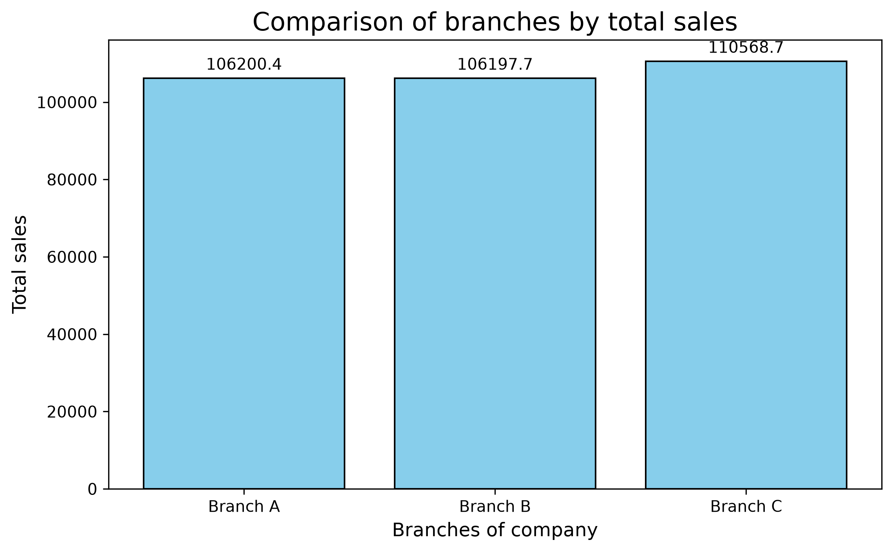

# Supermarket Sales Analysis
The dataset used for analysis contains 1000 rows and 17 columns.
##  objectives of the research

- Check for duplicate and missing data.
- Inspect dates,quantities and prices for suspicious values.
- Calculate total sales,average transaction value,total quantity sold and average customer rating.
- Compare sales across branches,product lines and customer types.

## Tools used for analysis

- pandas
- matplotlib
- numpy

## Findings

- The dataset was  checked and found out that it was clean.
- After inspecting Dates we found out that it is true that the dataset lies within the given three-month period.
- Inspection of Quantity had no problems at all.
- Inspection of Unit prices had no problems.

### SUMMARY OF INSPECTIONS
- Missing dates: 0
- Zero or negative quantities: 0
- Zero or negative prices: 0
- Missing quantities: 0
- Missing prices: 0

## Comparison of sales of the three branches
1.  ***Total Sales***
- Branch C had the highest amount of sales of 110568.706
- Branch B had the lowest amount od sales of 106197.672
- Therefore,having a range of 4371.035
- Branch A has the middle amount of sales.

# Visualization

**The chart below shows the comparison of total sales across the three branches during the three-month period.**

2. ***Average sales***

- Branch C had the highest amount of average sales of 337.1
- Branch A had the lowest mount of average sales of 312.4
- Therefore,having a range of 24.746
- Branch B has the middle average sales.

**The chart below shows the comparison of average sales across the three branches during the three-month period.**

3. ***Quantity of goods***

- Branch A had the highest Quantity of goods of 1859.
- Branch B had the lowest Quantity of goods 1820.
- Therefore, having  a range of 39.0
- Branch C has a middle Quantity of goods.

**The chart below shows the summary of Quantity of goods of the three branches**

4.***Rating***

**The pie chart below shows the ratings of the three branches**

- As we can see branch C has the highest rating by the customers.
- Also branch B has the least customer rating.
- Branch A has the middle rating .

# Conclusion from the findings

- Branch C has the ***highest amount of sales,customer ratings yet,it has a bit less quantity of goods than Branch A.***.
  ### What does this explain
- This tells that if branch C is added is supplied more goods more profits are going to be made.
 
###  spread of data
- The standard deviation of branch A sales is: 231.64
- The standard deviation of branch B sales is: 242.45
- The standard deviation of branch C sales is: 263.16

- The spread of data is even across the branches showing that there is lower risk of investing on the three branches.

## Conclusion

- This project has helped me understand how data can be analyzed and create useful visualizations that can be used to find useful trends and pattens.
Overall the findings provide a clear foundation for further analysis and future improvements.